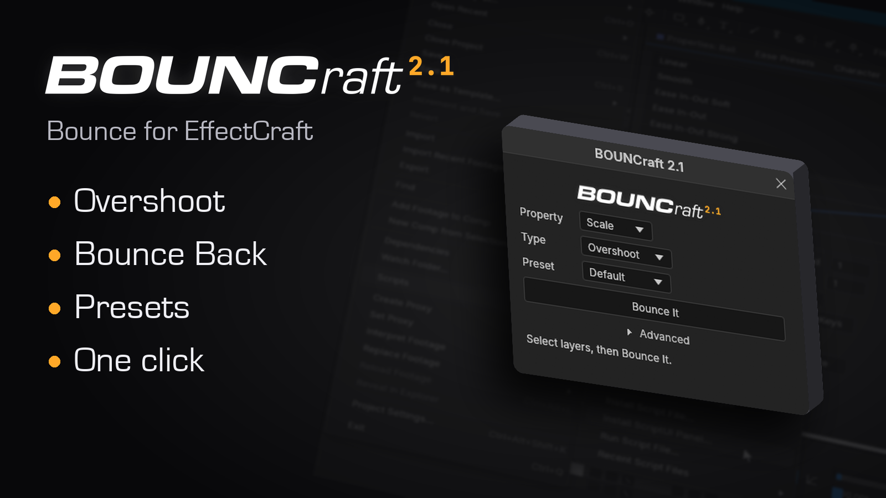
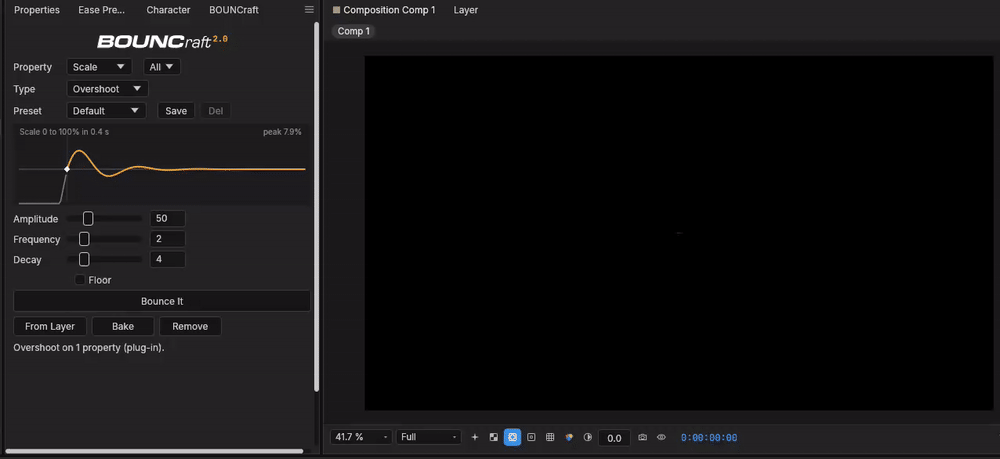
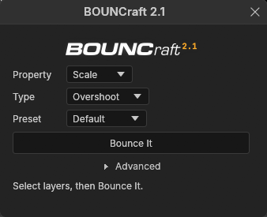
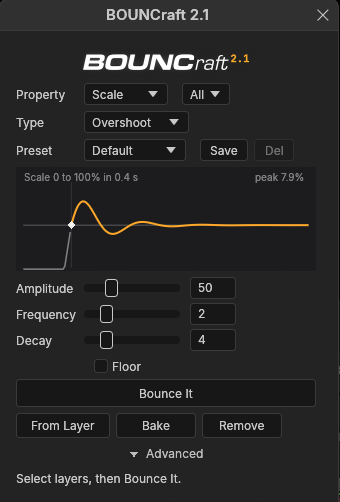

<p align="center"></p>

# BOUNCraft

**Overshoot and bounce for [EffectCraft](https://github.com/storytold/effectcraft), in one click.**

Animate with two keyframes, select the layer, press **Bounce It**. BOUNCraft keeps the motion going
after the last keyframe, so it lands with life instead of just stopping.

<p align="center"></p>

## What it does

- **Overshoot**: swings past the keyframe and settles, like a pendulum.
- **Bounce Back**: bounces off it, like a ball on the floor.
- Works on **Position**, **Scale**, **Rotation**, or any property you select.
- **Presets** to pick a feel fast: Subtle, Snappy, Rubbery, Heavy…

The panel starts simple. Open **Advanced** when you want more:

<p align="center">

&nbsp;&nbsp;

</p>

- **Preview**: see the curve before you apply.
- **Values**: set every number, and save your own presets.
- **Axis**: bounce only on X, Y or Z.
- **Bake**: turn the bounce into normal keyframes.
- **Remove**: take it off again.

# INSTALL

1. Download **BOUNCraft-2.1.zip** from the [latest release](../../releases/latest) and unzip it.
2. In EffectCraft: **File > Scripts > Install ScriptUI Panel...** and pick `BOUNCraft.jsx`.
3. Restart EffectCraft and open **Window > BOUNCraft.jsx**.

Prefer to do it by hand? Copy `BOUNCraft.jsx` to this folder, then restart EffectCraft:

```
%APPDATA%\EffectCraft\Scripts\ScriptUI Panels\
```

## How to use

1. Animate a property with at least two keyframes (for example, Scale from 0 to 100).
2. Select the layer.
3. Pick the property and the type, then **Bounce It**.

Want to tweak it after? The values are on the layer, in **Effect Controls**.

## Credits

Made by **Hugo Mec** ([@hugoeditor_](https://x.com/hugoeditor_)).
The bounce maths follow Dan Ebberts' inertial bounce and bounce-back expressions
([motionscript.com](https://www.motionscript.com)).
Inspired by the BOUNCr script by pixelbot; written from scratch, no shared code.

Found a bug or have an idea? Open an [issue](../../issues). License: [MIT](LICENSE)
