
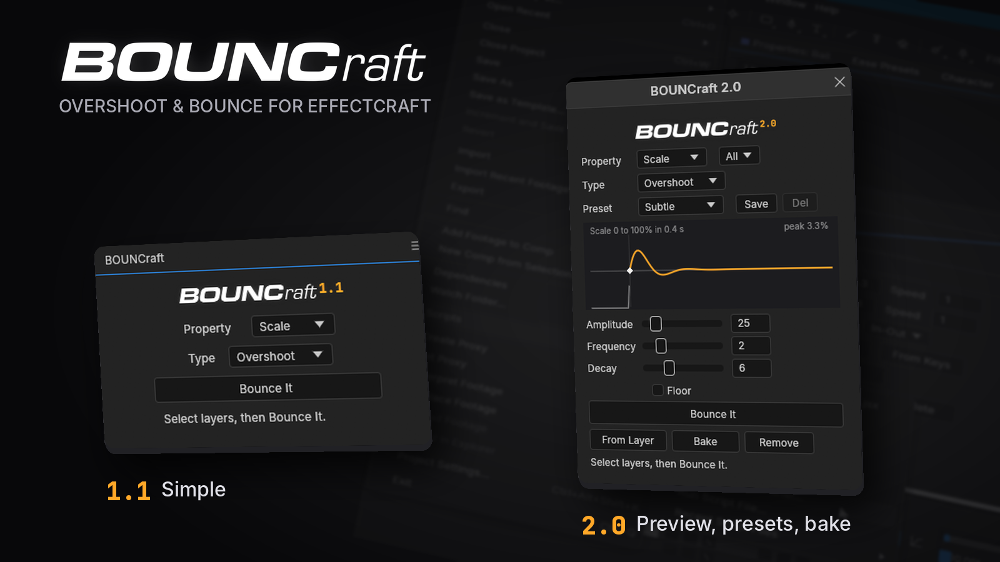

# BOUNCraft

Bounce and overshoot for [EffectCraft](https://github.com/storytold/effectcraft) in one click.

Select a layer, pick **Position**, **Scale** or **Rotation** (or **Selected** for any property you
selected, including the Transform effect's), choose **Overshoot** or **Bounce Back**, and press
**Bounce It**. BOUNCraft adds the expression and the controls to tweak it.

*[Português abaixo](#português)*

## Which version?

Two versions, both available: pick the one you like.

| | [BOUNCraft 1.1](#bouncraft-11) | [BOUNCraft 2](#bouncraft-2) |
|---|---|---|
| For | quick and simple | more control |
| Panel | Property, Type, **Bounce It** | the same, plus axis, presets, values, curve preview, **Bake**, **Remove**, **From Layer** |
| Controls on the layer | one Slider / Checkbox Control per value | the same, or one effect with the optional plug-in |
| Download | [1.1 release](../../releases/tag/v1.1): `BOUNCraft.jsx` | [2.0 release](../../releases/tag/v2.0): `BOUNCraft.jsx`, or `BOUNCraft-2.0-Plugin.zip` with the plug-in |

Both install as **Window ▸ BOUNCraft.jsx**, so installing one replaces the other. Layers you already
bounced keep working whichever one is installed (layers made with the plug-in need the plug-in).

## BOUNCraft 2

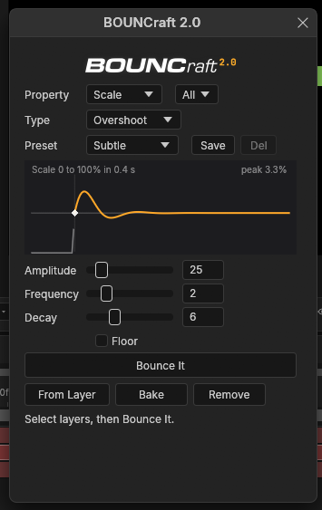

What's new in 2.0:

- **Curve preview.** The panel draws the motion after the keyframe and updates as you change the
  values. The peak shows how far it goes past the keyframe.
- **Values in the panel.** Sliders and fields for every value. **Bounce It** applies them, and
  updates a layer that already has BOUNCraft.
- **Presets.** Built-in ones (Subtle, Snappy, Rubbery, Heavy, Thud; Bouncy, Floaty for Bounce
  Back) and your own: **Save** names one, **Del** deletes it. They're kept between sessions.
- **One axis.** **All**, **X**, **Y** or **Z** next to the property: bounce a Position only on Y,
  for example.
- **On / Off.** An **On** checkbox in the controls turns the bounce off without removing it.
- **Bake.** Turns the bounce into keyframes (one per frame until it settles) and removes the
  expression and the controls.
- **Remove.** Takes BOUNCraft off the selected layers or properties.
- **From Layer.** Loads the values of the selected layer into the panel, to tweak them or save
  them as a preset.
- **Effect plug-in (optional).** All the values in one effect, **BOUNCraft Overshoot** or
  **BOUNCraft Bounce Back**, instead of one effect per value. See [Install](#install).

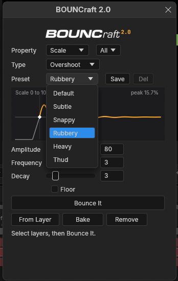
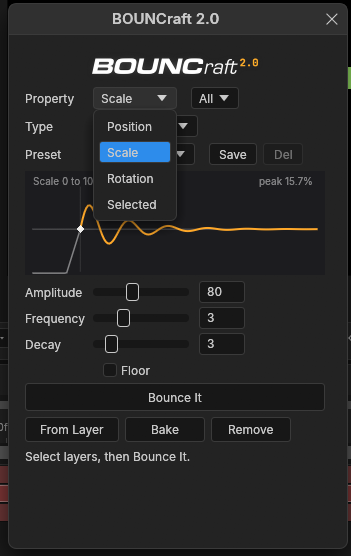
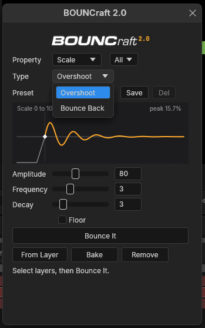

Layers made with 1.x keep working, and Bake and Remove work on them too.

### Install

Download from the [2.0 release](../../releases/tag/v2.0). It comes in two forms; pick one:

| | Script | Script + plug-in |
|---|---|---|
| Download | `BOUNCraft.jsx` | `BOUNCraft-2.0-Plugin.zip` |
| Controls on the layer | one Slider / Checkbox Control per value | one effect, **BOUNCraft Overshoot** or **BOUNCraft Bounce Back**, with every value inside |
| Opening your project on another computer | works in any EffectCraft | that computer needs the plug-in too |

#### Script

1. In EffectCraft: **File ▸ Scripts ▸ Install ScriptUI Panel…** and pick `BOUNCraft.jsx` (it
   replaces an older BOUNCraft).

   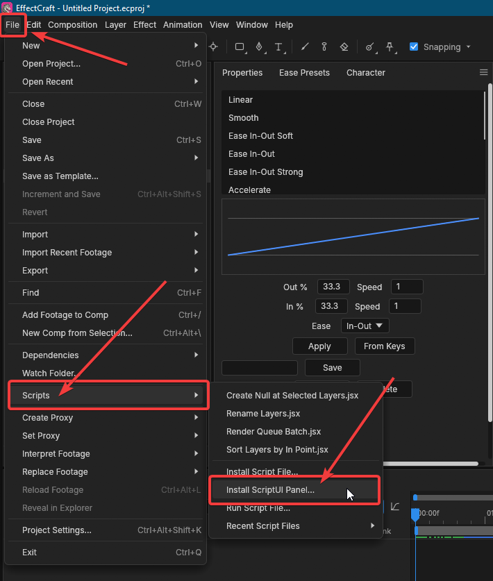 Scripts > Install ScriptUI Panel..." width="440">

   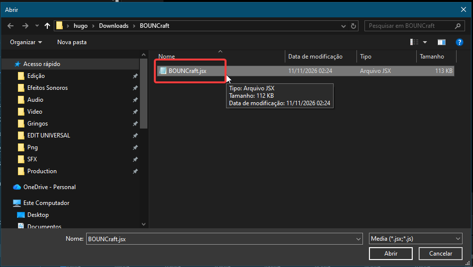

2. Restart EffectCraft and open it from the bottom of the **Window** menu (**Window ▸
   BOUNCraft.jsx**). It docks like any panel.

   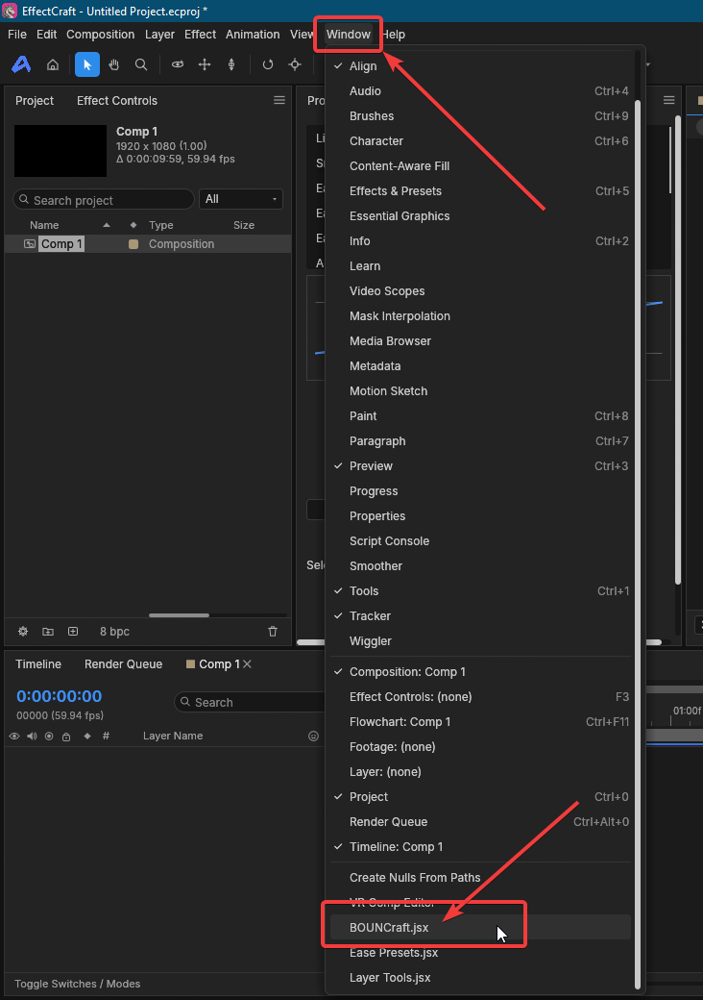 BOUNCraft.jsx" width="400">

To try it without installing: **File ▸ Scripts ▸ Run Script File…** opens it as a floating window.

#### Script + plug-in

1. Unzip `BOUNCraft-2.0-Plugin.zip`.
2. In EffectCraft: **Effect ▸ Install Effect Plug-in Bundle (Folder)…** and pick the unzipped
   `BOUNCraft` folder. It installs the two effects and the panel.
3. Already have an older BOUNCraft panel? EffectCraft doesn't overwrite it: also do **File ▸
   Scripts ▸ Install ScriptUI Panel…** with the `BOUNCraft.jsx` from the folder.
4. Restart EffectCraft and open **Window ▸ BOUNCraft.jsx**.

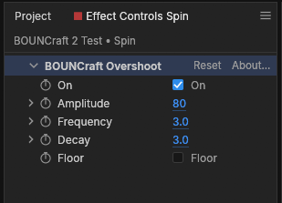

With the plug-in installed, **Bounce It** adds the BOUNCraft effect. A layer that already has the
Slider / Checkbox controls keeps them.

The effect is switched off (its **fx** switch) on purpose: it only holds the values, the
expression reads them anyway, and switched off it adds nothing to render times. Use the **On**
checkbox inside it to turn the bounce off.

### Use

1. Animate the property with at least two keyframes (for example Scale from 0 to 100).
2. Select the layer (or, for **Selected**, the property itself in the timeline).
3. Pick the property, the axis and the type, choose a preset or set the values, then **Bounce It**.

The motion starts at the last keyframe and keeps the speed the property had when it got there.

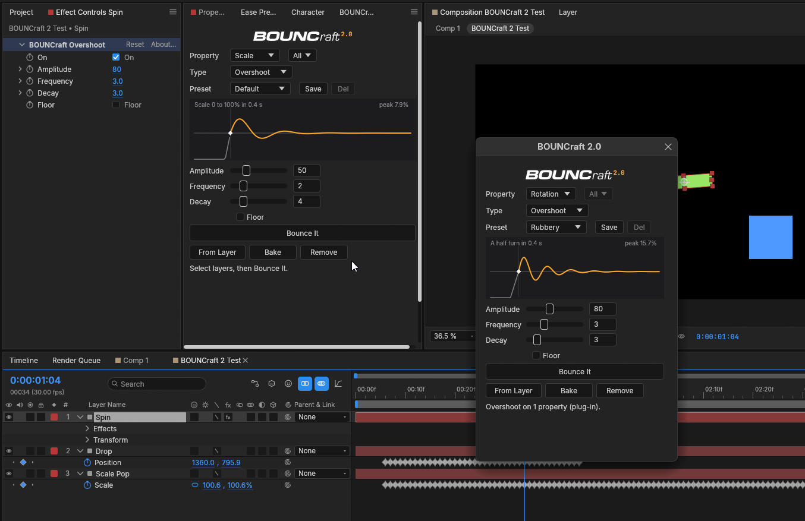

#### Overshoot (swings like a pendulum)

| Value | Default | What it does |
|---|---|---|
| Amplitude | 50 | How far it swings past the keyframe. |
| Frequency | 2 | Swings per second. |
| Decay | 4 | How fast it settles. Higher stops sooner. |
| Floor | off | Swings only to one side, as if it hits a floor. |
| On | on | Turns the bounce off without removing it. |

#### Bounce Back (bounces like a ball on the floor)

| Value | Default | What it does |
|---|---|---|
| Elasticity | 50 | How bouncy it is. |
| Gravity | 50 | How hard it's pulled back. Lower gives bigger, slower bounces. |
| Max Bounces | 10 | Stops after this many bounces. |
| On | on | Turns the bounce off without removing it. |

Bounce Back grows with the size of the move: it shows well on a Position move of a few hundred
pixels, and is subtle on Scale. The preview shows a typical move for the property you picked.

#### Bake

**Bake** writes the motion as keyframes, one per frame, and removes the expression and the
controls. Use it to hand the project to someone without BOUNCraft, or to edit the keyframes by hand.

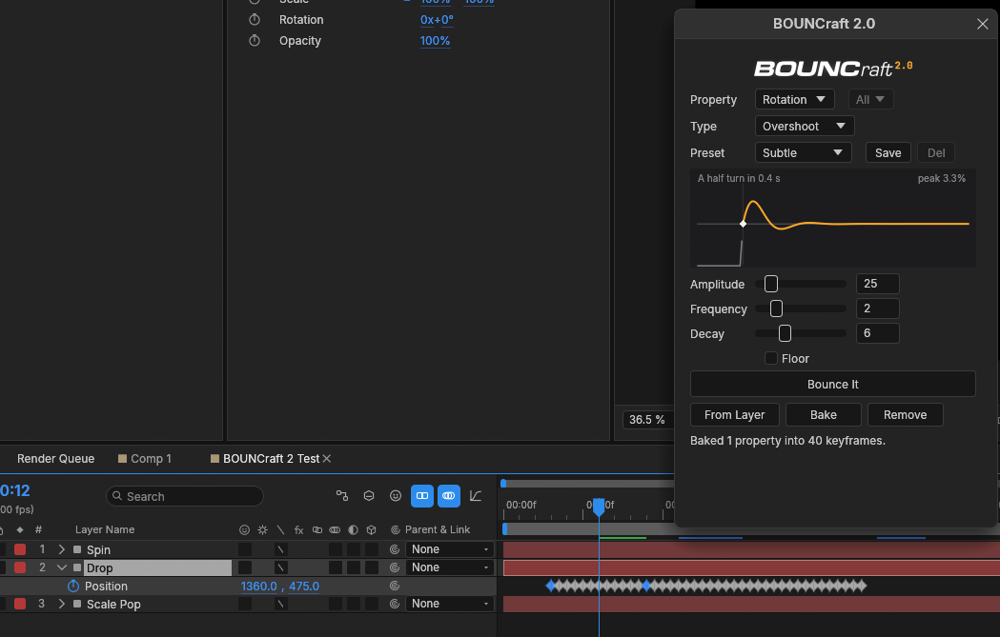

#### Good to know

- Applying to more properties of the same layer shares one set of controls.
- Switching a property from Overshoot to Bounce Back (or back) removes the old controls once
  nothing uses them.
- **Bake** and **Remove** work on the selected properties, or on every BOUNCraft property of the
  selected layers.
- Each action is one undo step.
- Messages show at the bottom of the panel.

## BOUNCraft 1.1

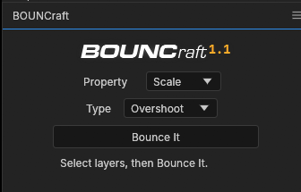

The simple one: pick the property and the type, then **Bounce It**. The values are tweaked in
Effect Controls.

### Install

1. Download `BOUNCraft.jsx` from the [1.1 release](../../releases/tag/v1.1).
2. In EffectCraft: **File ▸ Scripts ▸ Install ScriptUI Panel…** and pick `BOUNCraft.jsx`.

    Scripts > Install ScriptUI Panel..." width="440">

   

3. Open it from the bottom of the **Window** menu (**Window ▸ BOUNCraft.jsx**). It docks like any panel.

    BOUNCraft.jsx" width="400">

To try it without installing: **File ▸ Scripts ▸ Run Script File…** opens it as a floating window.

### Use

1. Animate the property with at least two keyframes (for example Scale from 0 to 100).
2. Select the layer (or, for **Selected**, the property itself in the timeline).
3. Pick the property and the type, then **Bounce It**.

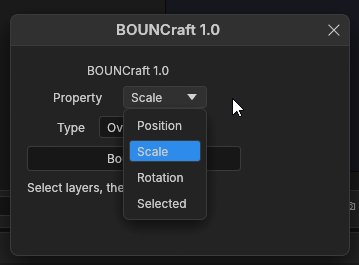
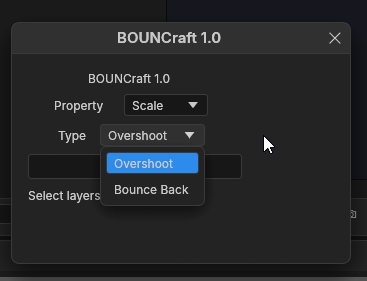

The motion starts at the last keyframe and keeps the speed the property had when it got there.

#### Overshoot (swings like a pendulum)

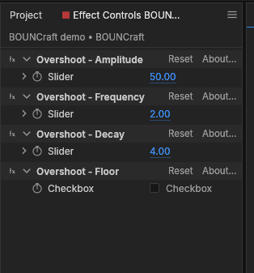

| Control | Default | What it does |
|---|---|---|
| Overshoot - Amplitude | 50 | How far it swings past the keyframe. |
| Overshoot - Frequency | 2 | Swings per second. |
| Overshoot - Decay | 4 | How fast it settles. Higher stops sooner. |
| Overshoot - Floor | off | Swings only to one side, as if it hits a floor. |

#### Bounce Back (bounces like a ball on the floor)

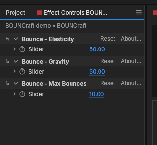

| Control | Default | What it does |
|---|---|---|
| Bounce - Elasticity | 50 | How bouncy it is. |
| Bounce - Gravity | 50 | How hard it's pulled back. Lower gives bigger, slower bounces. |
| Bounce - Max Bounces | 10 | Stops after this many bounces. |

Bounce Back is subtle with the defaults on fast moves: lower Gravity or raise Elasticity to see more.

#### Good to know

- Applying to more properties of the same layer shares one set of controls.
- Switching a property from Overshoot to Bounce Back (or back) removes the old controls once
  nothing uses them.
- Each apply is one undo step.
- Messages show at the bottom of the panel.

## Feedback

Found a bug or have an idea? Open an [issue](../../issues).

## Credits

- Made by **Hugo Mec** — [@hugoeditor_](https://x.com/hugoeditor_)
- The bounce maths follow Dan Ebberts' inertial bounce and bounce-back expressions
  ([motionscript.com](https://www.motionscript.com)).
- Inspired by the BOUNCr script by pixelbot. BOUNCraft is a new script written from scratch; it
  shares no code with BOUNCr.

License: [MIT](LICENSE)

---

## Português

Bounce e overshoot no [EffectCraft](https://github.com/storytold/effectcraft) com um clique.

Selecione uma layer, escolha **Position**, **Scale** ou **Rotation** (ou **Selected** para qualquer
propriedade selecionada, inclusive as do efeito Transform), escolha **Overshoot** ou **Bounce Back** e
clique em **Bounce It**. O BOUNCraft coloca a expressão e os controles para ajustar.

### Qual versão?

São duas versões, as duas continuam disponíveis: escolha a que preferir.

- **[BOUNCraft 1.1](#bouncraft-11-1)**, o simples: Property, Type e **Bounce It**. Baixe na
  [release 1.1](../../releases/tag/v1.1).
- **[BOUNCraft 2](#bouncraft-2-1)**, o mais completo: eixo, presets, valores e prévia da curva no
  painel, **Bake**, **Remove**, **From Layer** e o plug-in de efeito opcional. Baixe na
  [release 2.0](../../releases/tag/v2.0).

As duas aparecem como **Window ▸ BOUNCraft.jsx**, então instalar uma substitui a outra. As layers que
você já animou continuam funcionando com qualquer uma instalada (as feitas com o plug-in precisam do
plug-in).

### BOUNCraft 2

Novidades da 2.0:

- **Prévia da curva:** o painel desenha o movimento depois do keyframe e muda na hora quando você
  mexe nos valores. O "peak" mostra quanto passa do keyframe.
- **Valores no painel:** sliders e campos para cada valor. O **Bounce It** aplica com eles e
  atualiza a layer que já tem BOUNCraft.
- **Presets:** os prontos (Subtle, Snappy, Rubbery, Heavy, Thud; Bouncy e Floaty no Bounce Back) e
  os seus: **Save** salva com um nome, **Del** apaga. Ficam salvos entre sessões.
- **Um eixo só:** **All**, **X**, **Y** ou **Z** ao lado da propriedade. Por exemplo, quicar a
  Position só no Y.
- **Liga/desliga:** o checkbox **On** nos controles desliga o bounce sem tirar.
- **Bake:** transforma o bounce em keyframes (um por frame até parar) e tira a expressão e os
  controles.
- **Remove:** tira o BOUNCraft das layers ou propriedades selecionadas.
- **From Layer:** carrega no painel os valores da layer selecionada, para ajustar ou salvar como
  preset.
- **Plug-in de efeito (opcional):** todos os valores num efeito só, **BOUNCraft Overshoot** ou
  **BOUNCraft Bounce Back**, em vez de um efeito por valor.

Layers feitas com a 1.x continuam funcionando, e o Bake e o Remove funcionam nelas.

#### Instalar

Baixe na [release 2.0](../../releases/tag/v2.0). São duas formas, escolha uma:

- **Só o script** (`BOUNCraft.jsx`): **File ▸ Scripts ▸ Install ScriptUI Panel…**, escolha o
  `BOUNCraft.jsx`, reinicie o EffectCraft e abra **Window ▸ BOUNCraft.jsx**. Os controles ficam
  como um Slider / Checkbox Control por valor, e o projeto abre em qualquer EffectCraft.
- **Script + plug-in** (`BOUNCraft-2.0-Plugin.zip`): descompacte, use **Effect ▸ Install Effect
  Plug-in Bundle (Folder)…** e escolha a pasta `BOUNCraft`. Se você já tem um BOUNCraft instalado,
  faça também **File ▸ Scripts ▸ Install ScriptUI Panel…** com o `BOUNCraft.jsx` da pasta (o
  EffectCraft não substitui o painel antigo sozinho). Reinicie e abra **Window ▸ BOUNCraft.jsx**.
  Os controles ficam num efeito só. Quem abrir o seu projeto em outro computador precisa do
  plug-in também.

O efeito do plug-in fica com o **fx** desligado de propósito: ele só guarda os valores, a expressão
lê assim mesmo, e desligado não pesa no render. Para desligar o bounce, use o **On** dentro dele.

#### Usar

1. Anime a propriedade com pelo menos dois keyframes (por exemplo Scale de 0 a 100).
2. Selecione a layer (ou, no modo **Selected**, a propriedade na timeline).
3. Escolha a propriedade, o eixo e o tipo, um preset ou os valores, e clique em **Bounce It**.

O movimento começa no último keyframe e continua com a velocidade que a propriedade tinha ao chegar nele.

**Overshoot** (balança como pêndulo): Amplitude (quanto passa do keyframe), Frequency (balanços por
segundo), Decay (quanto mais alto, mais rápido para), Floor (balança só para um lado, como se batesse
no chão) e On.

**Bounce Back** (quica como bola): Elasticity (quanto quica), Gravity (quanto puxa de volta; mais
baixo dá quiques maiores), Max Bounces (para depois desse número de quiques) e On. O Bounce Back
cresce com o tamanho do movimento: aparece bem numa Position de algumas centenas de pixels e é
sutil no Scale.

- **Bake** grava o movimento em keyframes e tira a expressão e os controles: bom para mandar o
  projeto para quem não tem o BOUNCraft.
- Várias propriedades da mesma layer usam os mesmos controles.
- Trocar de Overshoot para Bounce Back remove os controles antigos quando nada mais usa eles.
- Cada ação é um passo de desfazer (Ctrl+Z).
- As mensagens aparecem no rodapé do painel.

### BOUNCraft 1.1

O simples: escolha a propriedade e o tipo e clique em **Bounce It**. Os valores se ajustam no
Effect Controls.

#### Instalar

1. Baixe o `BOUNCraft.jsx` na [release 1.1](../../releases/tag/v1.1).
2. No EffectCraft: **File ▸ Scripts ▸ Install ScriptUI Panel…** e escolha o `BOUNCraft.jsx`.

    Scripts > Install ScriptUI Panel..." width="440">

   

3. Abra pelo fim do menu **Window** (**Window ▸ BOUNCraft.jsx**). Ele encaixa como qualquer painel.

    BOUNCraft.jsx" width="400">

Para testar sem instalar: **File ▸ Scripts ▸ Run Script File…** abre como janela solta.

#### Usar

1. Anime a propriedade com pelo menos dois keyframes (por exemplo Scale de 0 a 100).
2. Selecione a layer (ou, no modo **Selected**, a propriedade na timeline).
3. Escolha a propriedade e o tipo e clique em **Bounce It**.

O movimento começa no último keyframe e continua com a velocidade que a propriedade tinha ao chegar nele.

**Overshoot** (balança como pêndulo): Amplitude (quanto passa do keyframe), Frequency (balanços por
segundo), Decay (quanto mais alto, mais rápido para) e Floor (balança só para um lado, como se batesse
no chão).

**Bounce Back** (quica como bola): Elasticity (quanto quica), Gravity (quanto puxa de volta; mais
baixo dá quiques maiores) e Max Bounces (para depois desse número de quiques). Com os valores padrão o
quique é sutil em movimentos rápidos: diminua o Gravity ou aumente o Elasticity.

- Várias propriedades da mesma layer usam os mesmos controles.
- Trocar de Overshoot para Bounce Back remove os controles antigos quando nada mais usa eles.
- Cada aplicação é um passo de desfazer (Ctrl+Z).
- As mensagens aparecem no rodapé do painel.

### Feedback

Achou um bug ou tem uma ideia? Abra uma [issue](../../issues).

### Créditos

- Feito por **Hugo Mec** — [@hugoeditor_](https://x.com/hugoeditor_)
- As contas do bounce seguem as expressões de inertial bounce e bounce-back do Dan Ebberts
  ([motionscript.com](https://www.motionscript.com)).
- Inspirado no script BOUNCr, do pixelbot. O BOUNCraft é um script novo, escrito do zero, sem código
  do BOUNCr.

Licença: [MIT](LICENSE)
